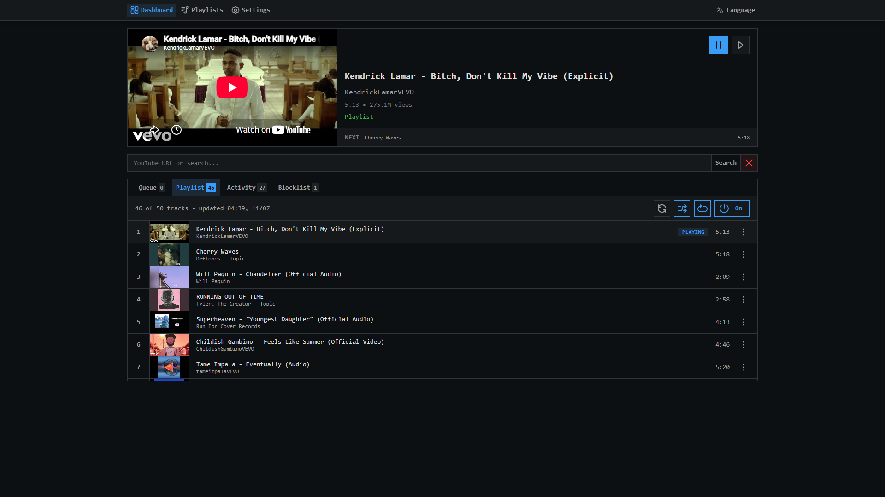
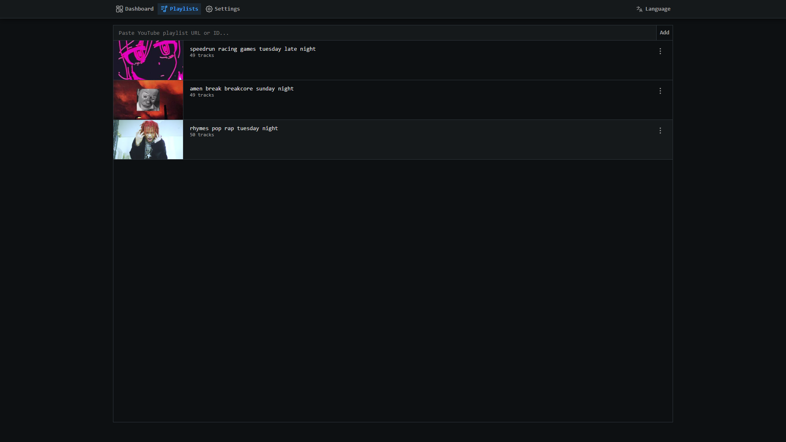
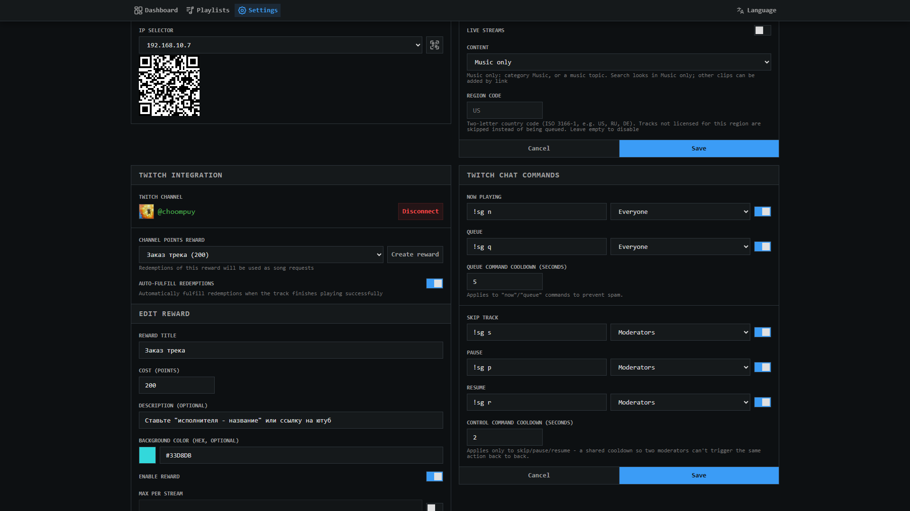
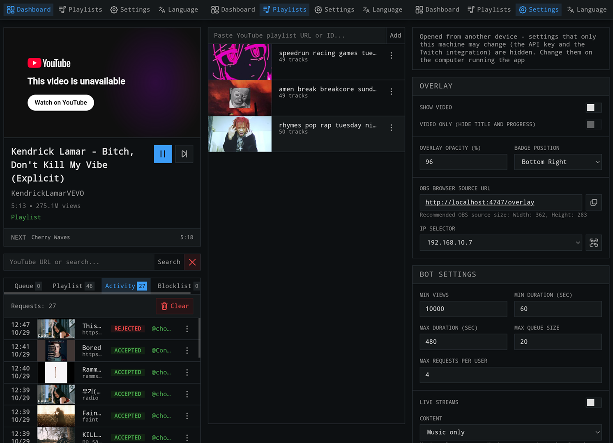

# StreamQueue

🎵 **Self-hosted YouTube song request queue for Twitch streams.**

StreamQueue lets your viewers request songs through Twitch Channel Points. It searches YouTube, checks videos against your filters, manages the queue, and plays music directly through an OBS Browser Source.

Everything runs locally on your computer and is managed through a web control panel. No cloud services or manual configuration files required.

<p align="center">
  <a href="https://github.com/choompuy/stream-queue/releases/latest">
    
  </a>
  <a href="https://github.com/choompuy/stream-queue/releases">
    
  </a>
  <a href="LICENSE">
    
  </a>
</p>

<p align="center">
  <a href="https://github.com/choompuy/stream-queue/releases/latest"><strong>⬇️ Download the latest release</strong></a>
</p>



<details>
<summary>More screenshots</summary>

|                                              |                                                  |
| -------------------------------------------- | ------------------------------------------------ |
| Main dashboard                               | Playlists                                        |
|  |      |
| Settings                                     | Mobile interface                                 |
|    |  |

## ✨ Features

- 🎵 **Song requests** – viewers can request songs by searching YouTube or submitting a video link.
- 📺 **Twitch integration** – connect your Twitch account directly, without Streamer.bot.
- 🎁 **Channel Points** – create and manage rewards, configure request costs, limits, cooldowns, and automatic fulfillment.
- 📋 **Queue management** – view, reorder, skip, and manage upcoming tracks.
- 🔁 **Fallback playlist** – keep music playing when the request queue is empty, with shuffle and repeat options.
- 🎶 **Saved playlists** – maintain multiple playlists and switch between them.
- 🚫 **Blocklist** – prevent unwanted tracks from being requested or played again.
- 🎛️ **Web control panel** – manage playback, requests, playlists, settings, and Twitch integration from one place.
- 🎬 **OBS overlay** – play music through an OBS Browser Source with a customizable Now Playing badge.
- 📊 **Activity log** – track accepted, rejected, blocked, and failed requests.
- 📱 **Mobile access** – manage your queue from another device over your local network.
- 🌍 **RU/EN interface** – switch between Russian and English.
- 💾 **Local storage** – application data and settings stay on your computer.
- ⚡ **Real-time updates** – queue and playback changes are synchronized without manual refreshing.
- 🖥️ **Windows standalone build** – run the application without installing Node.js.

## ⚙️ How it works

1. A viewer redeems your configured Channel Points reward and enters a song title or YouTube link.
2. StreamQueue searches YouTube and checks the video against your filters.
3. Valid requests are added to the queue.
4. The OBS overlay plays tracks automatically.
5. When the queue is empty, the fallback playlist takes over.

```text
Twitch Channel Points
        │
        ▼
   StreamQueue
        │
        ▼
 YouTube search + filters
        │
        ▼
      Queue
        │
        ▼
   OBS Overlay
```

## 🚀 Getting started

### 🪟 Windows release

The easiest way to get started is to download the prebuilt Windows release.

1. Download the [latest release](https://github.com/choompuy/stream-queue/releases/latest).
2. Extract the ZIP archive to a folder.
3. Run `Service.exe` or the optional `StreamQueue.exe` tray launcher.
4. Open the control panel.
5. Go to **Settings** and enter your YouTube Data API key.
6. Connect your Twitch account in the **Twitch** settings.
7. Add the `/overlay` URL as a Browser Source in OBS.

That's it. No Node.js installation or manual build is required.

The released build already includes the Twitch Client ID, so you don't need to create a Twitch application or provide a client secret.

### 🧰 Development requirements

If you want to run StreamQueue from source, you'll need:

- [Node.js](https://nodejs.org/) 24+
- [YouTube Data API v3](https://console.cloud.google.com/apis/library/youtube.googleapis.com) key
- A [Twitch application](https://dev.twitch.tv/console/apps) of type **Public** (only the Client ID is required)
- [.NET 10 SDK](https://dotnet.microsoft.com/download/dotnet/10.0) on Windows if you want to build the tray launcher

### 💻 Run locally

```bash
git clone https://github.com/choompuy/stream-queue.git
cd stream-queue
npm install
cp .env.example .env
npm run dev
```

On Windows Command Prompt, use `copy .env.example .env` instead of `cp`.

Add your Twitch Client ID to `.env`:

```env
TWITCH_CLIENT_ID=your_client_id
```

Without a Client ID, everything works except connecting Twitch.

The server uses port `4747`. If the port is already occupied, StreamQueue automatically selects another available port and remembers it.

Configure your YouTube API key directly from the control panel. Changes take effect without restarting the server.

## 🎬 OBS setup

1. Open OBS and add a **Browser Source**.
2. In StreamQueue, go to **Settings → Overlay**.
3. Copy the OBS Browser Source URL.
4. Paste it into the Browser Source URL field in OBS.
5. Adjust the source dimensions to match your overlay layout. `362 × 283` is a reasonable starting point.

The overlay plays the current track and can display a compact Now Playing badge with the track title, requester, and playback progress.

## 🎮 Twitch integration

StreamQueue connects directly to Twitch without requiring additional bots or external automation tools.

Available features:

- Connect and disconnect your Twitch account.
- Configure chat commands for current track and queue information.
- Allow moderators to skip, pause, and resume playback.
- Customize command permissions and cooldowns.
- Create and manage Channel Points rewards.
- Configure reward costs, limits, cooldowns, and automatic fulfillment.
- Send request and playback status messages directly to Twitch chat.

Default chat commands:

| Command      | Description            | Permission |
| ------------ | ---------------------- | ---------- |
| `!sg now`    | Show the current track | Everyone   |
| `!sg queue`  | Show upcoming tracks   | Everyone   |
| `!sg skip`   | Skip the current track | Moderators |
| `!sg pause`  | Pause playback         | Moderators |
| `!sg resume` | Resume playback        | Moderators |

Commands, permissions, and cooldowns can be customized in the control panel.

## 🎛️ Configuration

Most settings can be managed directly from the control panel.

| Setting            | Default            |
| ------------------ | ------------------ |
| Minimum views      | 10,000             |
| Minimum duration   | 60 seconds         |
| Maximum duration   | 480 seconds        |
| Maximum queue size | 20 (0 = unlimited) |
| Requests per user  | 4 (0 = unlimited)  |
| Region             | None               |
| Allow live streams | Disabled           |
| Content category   | Music              |
| Fallback playlist  | None               |

YouTube requests are checked for availability, embeddability, duration, view count, and other configured restrictions.

Fallback playlist tracks have separate availability checks and are not subject to viewer request filters.

## 🛡️ Moderation

The built-in blocklist helps prevent unwanted tracks from appearing in your stream.

You can block tracks directly from Activity, Queue, or fallback entries.

Blocked tracks are:

- Rejected when requested again.
- Removed from the active queue when applicable.
- Skipped during fallback playback.
- Kept blocked until manually unblocked.

## 🔒 Data & privacy

StreamQueue runs locally on your computer. Application data, settings, playlists, queue state, and credentials are stored alongside the executable in the `data/` directory.

Your YouTube API key and Twitch OAuth tokens are stored locally. External communication is limited to the services required for YouTube and Twitch integration.

## 🧪 Tests

```bash
npm run typecheck
npm run lint
npm test
npm run test:smoke
```

GitHub Actions runs checks on pushes to `main` and pull requests, and builds the Windows release.

## 🛠️ Tech stack

Node.js · TypeScript · Express · Vanilla JavaScript · YouTube Data API v3 · YouTube IFrame Player API · Twitch APIs · Twitch EventSub WebSocket · Server-Sent Events · C# / WinForms (.NET 10)

## 📄 License

[MIT](LICENSE) – © choompuy
